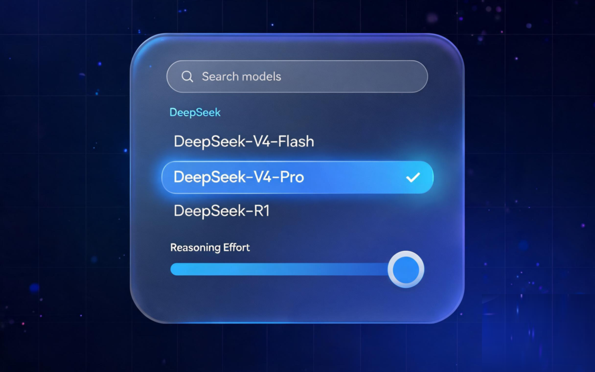
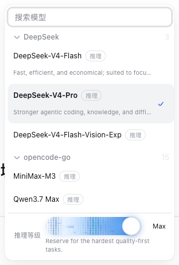
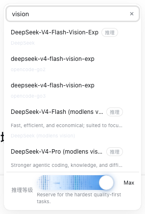

# @bittersmilezzz/dsh-model-selector

<p align="center">
  
</p>

<p align="center">
  <a href="https://www.npmjs.com/package/@bittersmilezzz/dsh-model-selector"></a>
  <a href="https://github.com/awesome-dsh-plugin/awesome-dsh-plugin"></a>
  <a href="https://dsh-plugin.org"></a>
  <a href="LICENSE"></a>
</p>

**增强模型选择器（Model Selector）** —— DeepSeek Harness (DSH) 增强模型选择器：单层快速菜单（搜索 + 供应商分组）+ 底部内联 Codex 风格推理强度滑杆。已收录于 [awesome-dsh-plugin](https://github.com/awesome-dsh-plugin/awesome-dsh-plugin) 与 [dsh-plugin.org](https://dsh-plugin.org)。

## 界面预览

默认菜单（分组 + 推理滑杆） | 实时搜索过滤
:---: | :---:
 | 

## 特性

- **单层聚合菜单**：开箱即选，支持按提供商折叠分组与当前选中项自动定位。
- **宽容模糊搜索**：大小写与变音符折叠匹配，高亮命中片段。
- **内联推理滑杆**：Codex 式三段式布局，最高档呈现平滑蓝紫渐变与粒子效果。
- **完整键盘导航**：方向键巡检、Enter 选中首项、Escape 快速清词，IME 输入无冲突。
- **原生无缝集成**：纯前端组件，自动同步官方目录状态与会话，无需配置。
- **稳定轻量**：独立合成层防抖防闪烁，123 项测试全绿保障。

## 安装

推荐直接通过 npm 安装：

```bash
# 安装到当前 profile（以 web 为例）
dsh plugin --profile web add @bittersmilezzz/dsh-model-selector
```

启用后刷新页面即可生效。也可在 DSH 客户端「插件中心」内一键搜索安装。

## 兼容性与权限

- **兼容环境**：DSH `^0.2.1-rc.2`，Node.js `>=22.19.0`（纯 client Web 插件）。
- **权限等级：low**。纯前端 UI 插件，不注册 host 工具、不读写宿主文件、不访问凭据、不发起自有网络请求。数据均走官方 session RPC。

## 外部依赖

- 运行时依赖 DSH web profile（依赖 `@deepseek-ai/dsh-client-ui-slots` 等官方注入包）。
- 无系统级依赖，无任何 npm 生命周期脚本（无 preinstall/install/postinstall）。

## 已知风险

- **官方 Slot 覆盖**：通过 `priority: -1` shadow 覆盖官方模型选择座位，若官方后续调整该 slot 结构需同步适配。
- **子座位继承限制**：接管期间官方 `conversation.input.model.label` 子座位的第三方贡献暂不被渲染。
- **同类插件互斥**：与其他覆盖同座位的第三方插件共存时，由 slot 优先级决定胜出方。

## 开发与测试

```bash
pnpm install
pnpm typecheck          # 双 program 类型检查
pnpm test               # 123 项自动化测试全绿
pnpm build              # 构建 lib 产物
pnpm validate:registry  # 伞仓准入校验
```

## License

MIT
